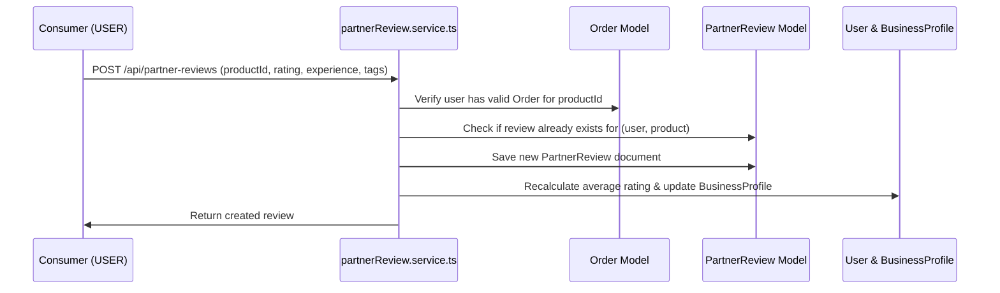

# Partner Review Module (`src/modules/partnerReview`)

The **Partner Review Module** enables consumers (`USER`) to review merchant partners (`BUSINESS`) and redeemed marketplace products/vouchers, providing rating transparency, sentiment tags, and automatic reputation scoring.

---

## 1. Overview & Capabilities

- **Verified Claim/Redemption Gate**: Only users who have claimed or redeemed the item via `src/modules/order` are eligible to submit a review.
- **Self-Review Prevention**: Business owners cannot review their own products.
- **Single Review Constraint**: A compound unique index (`{ user: 1, product: 1 }`) prevents duplicate reviews from the same consumer on a single product.
- **Dynamic Rating Recalculation**: Submitting or deleting a review triggers aggregate recalculation, immediately updating `rating` in both `User` and `BusinessProfile`.
- **Rich Feedback Breakdown**: Computes star ratings (1 to 5), sentiment (`POSITIVE` vs `NEGATIVE`), and frequency-ranked tag analytics.

---

## 2. Directory Structure

```text
src/modules/partnerReview/
├── partnerReview.controller.ts    # Handlers for submitting reviews, eligibility checks, and breakdown stats
├── partnerReview.interface.ts     # TypeScript interfaces for IPartnerReview, queries, stats, and eligibility
├── partnerReview.model.ts         # Mongoose schema, compound unique index, and references
├── partnerReview.route.ts         # Express routes for user actions and public statistics
├── partnerReview.service.ts       # Domain logic: eligibility verification, rating recalculation, aggregations
├── partnerReview.validation.ts   # Zod validation schemas for rating, tags, and query params
└── README.md                      # This documentation file
```

---

## 3. Data Model Reference (`PartnerReview`)

| Field | Type | Description |
| :--- | :--- | :--- |
| `user` | ObjectId | Reference to reviewing `User` |
| `product` | ObjectId | Reference to reviewed `Marketplace` item |
| `businessPartner`| ObjectId | Reference to merchant `User` (owner of the product) |
| `order` | ObjectId | Reference to `Order` validating the verified claim |
| `rating` | Number | Star score from 1 to 5 |
| `experience` | Enum | `'POSITIVE'` \| `'NEGATIVE'` |
| `tags` | Array of Strings | Quick tags (e.g. `"Great Value"`, `"Friendly Staff"`, `"Fast Service"`) |
| `feedback` | String | Detailed written comment (optional) |
| `createdAt` | Date | Creation timestamp |
| `updatedAt` | Date | Modification timestamp |

---

## 4. Endpoints & API Reference

Base Prefixes: `/api/partner-reviews` and `/api/business-reviews`

### Authenticated User Endpoints (`USER` role)
| Method | Endpoint | Description |
| :--- | :--- | :--- |
| `POST` | `/` | Submit a review for a redeemed marketplace item. Recalculates partner rating. |
| `GET` | `/check-eligibility/:productId` | Check if current user has an order for this item and has not yet reviewed it. |
| `GET` | `/my-reviews` | Fetch all partner reviews submitted by the authenticated user. |
| `DELETE` | `/:id` | Delete own review (or by Admin). Triggers partner rating recalculation. |

### Public Discovery Endpoints
| Method | Endpoint | Description |
| :--- | :--- | :--- |
| `GET` | `/product/:productId` | List all reviews for a specific marketplace product with stats and tag breakdown. |
| `GET` | `/partner/:partnerId` | List all reviews for a business partner across all their items with aggregate rating. |
| `GET` | `/:id` | Get single review by its ID. |

---

## 5. Business Logic & Recalculation Flow


