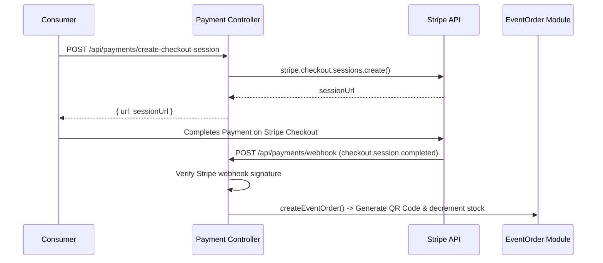

# Payment Module (`src/modules/payment`)

The **Payment Module** is the financial backbone of TeamStreak Promo. It coordinates all monetary transactions through Stripe, including ticket checkout sessions, Stripe Connect Express host onboarding, automated escrow payouts, event order refunds, and real-time Stripe webhooks.

---

## 1. Overview & Capabilities

- **Stripe Checkout Sessions**: Creates dynamic Stripe Checkout URLs with ticket line items, host identification metadata, and success/cancel callback redirects.
- **Stripe Connect Express Onboarding**: Generates Stripe Connect onboarding account links (`/create-connect-account`) allowing organizers to link bank accounts for receiving direct ticket payouts.
- **Stripe Express Dashboard Link**: Generates short-lived login links (`/create-login-link`) so hosts can view their Stripe earnings and tax documents directly.
- **Automated Payout Sweeper**: A background recurring scheduler (`payout.scheduler.ts`) executes every 15 minutes to automatically transfer event ticket proceeds to hosts whose events have finished.
- **Commission Split & Escrow**: Calculates and deducts platform service commission before issuing Stripe transfers (`stripe.transfers.create`) to connected accounts.
- **Secure Webhook Ingestion**: Receives raw Stripe event payloads at `/webhook` and verifies cryptographic HMAC signatures (`stripe.webhooks.constructEvent`).
- **Automated Ticket Refunds**: Issues Stripe refunds (`stripe.refunds.create`) for cancelled ticket orders and restores event ticket stock.

---

## 2. Directory Structure

```text
src/modules/payment/
├── payment.controller.ts    # Handlers for checkout, Connect onboarding, payouts, webhooks, and refunds
├── payment.interface.ts     # TypeScript interfaces for Stripe sessions, webhooks, and payout summaries
├── payment.route.ts         # Express routes for webhooks, checkout, Connect, and payouts
├── payment.service.ts       # Domain logic: Stripe API client calls, commission logic, and order creation
├── payment.validation.ts   # Zod validation schemas for checkout sessions and Connect account creation
├── payout.scheduler.ts      # Background recurring payout sweeper running on a timer
└── README.md                # This documentation file
```

---

## 3. Endpoints & API Reference

Base Prefix: `/api/payments`

| Method | Endpoint | Auth Required | Roles | Description |
| :--- | :--- | :--- | :--- | :--- |
| `POST` | `/webhook` | No (Stripe HMAC) | Stripe | Ingests Stripe webhook events (`checkout.session.completed`, `account.updated`). |
| `POST` | `/create-checkout-session` | Yes | Logged-in | Creates a Stripe Checkout session for event ticket purchase. Returns checkout URL. |
| `POST` | `/create-connect-account` | Yes | `HOST`, `BUSINESS`, `ADMIN` | Initializes Stripe Connect Express account and returns onboarding URL. |
| `GET` | `/account-status` | Yes | `HOST`, `BUSINESS`, `ADMIN` | Checks current status of organizer's Stripe Connect account (charges/payouts enabled). |
| `POST` | `/create-login-link` | Yes | `HOST`, `BUSINESS`, `ADMIN` | Generates a single-use login link to the host's Stripe Express dashboard. |
| `POST` | `/events/:eventId/payout` | Yes | `HOST`, `BUSINESS`, `ADMIN` | Manually triggers payout transfer for a concluded event. |
| `POST` | `/process-payouts` | Yes | `ADMIN` | Admin endpoint triggering a sweep across all eligible ended events. |
| `GET` | `/events/:eventId/payout-status` | Yes | `HOST`, `BUSINESS`, `ADMIN` | Inspect payout status, gross sales, platform fee, and net payout amount. |
| `POST` | `/event-orders/:orderId/cancel` | Yes | Any ticket owner, `ADMIN` | Cancels ticket order, issues Stripe refund, and returns ticket stock. |

---

## 4. Financial Flows & Architecture

### Checkout & Webhook Ticket Issuance


### Automated Payout Sweeper
- Started on application launch in `src/server.ts` via `startPayoutScheduler()`.
- Runs every 15 minutes (`15 * 60 * 1000` ms).
- Queries events where:
  - `endDate <= now`
  - `payoutStatus === 'PENDING'`
  - `isActive === true`
- Validates the host has an active Stripe Connect account with payouts enabled.
- Calculates gross ticket sales, platform commission fee, and transfers the net amount to the host.
- Updates `payoutStatus` to `'COMPLETED'` and stamps `stripeTransferId`.

---

## 5. Security & Best Practices

1. **Raw Body Parsing & Strict Webhook Verification**: The webhook endpoint receives raw unparsed buffer data to verify Stripe signature headers (`stripe-signature`). Unverified fallback payloads are strictly blocked in production (`NODE_ENV === 'production'`).
2. **Refund Cutoff & Atomic Reversal**: Ticket refunds are prohibited if the event start time is less than 10 minutes away. Ticket stock and earned points are reverted atomically.
3. **Double Payout Safeguard & Idempotency**: Payout status is atomically locked (`findOneAndUpdate` to `'PROCESSING'`) before dispatching Stripe transfer calls with an `idempotencyKey` (`payout_event_<eventId>`) to prevent duplicate payouts during concurrent sweeps.
