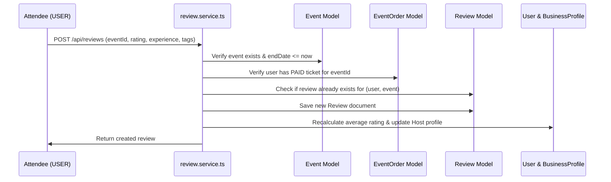

# Review Module (`src/modules/review`)

The **Review Module** provides event attendee rating and feedback management for concluded events and their organizers (`HOST`), incorporating star scores, attendee sentiment, and automated host reputation recalculation.

---

## 1. Overview & Business Rules

- **Verified Attendee Gate**: Only users who purchased a ticket via `src/modules/eventOrder` (status `'PAID'`) for the specific event are permitted to review.
- **Concluded Event Requirement**: Reviews can only be submitted after the event's `endDate` has passed.
- **Host Self-Review Prevention**: Event organizers cannot submit reviews on events they hosted.
- **Single Review Constraint**: A compound unique index (`{ user: 1, event: 1 }`) prevents duplicate reviews from the same user for a single event.
- **Host Reputation Recalculation**: Submitting or deleting a review automatically updates aggregate star ratings across all events for the host in `User` and `BusinessProfile`.
- **Review Analytics**: Generates aggregate ratings, star breakdowns (1-5), positive/negative sentiment splits, and frequency-ranked tags (e.g. `"Great Sound"`, `"Crowded"`, `"Well Organized"`).

---

## 2. Directory Structure

```text
src/modules/review/
├── review.controller.ts    # Handlers for submitting reviews, checking eligibility, and stats
├── review.interface.ts     # TypeScript interfaces for IReview, query filters, and eligibility
├── review.model.ts         # Mongoose schema, compound unique index, and references
├── review.route.ts         # Express routes for user review operations and public lookups
├── review.service.ts       # Domain logic: eligibility checks, host rating aggregation, deletion
├── review.validation.ts   # Zod validation schemas for review creation and query params
└── README.md               # This documentation file
```

---

## 3. Data Model Reference (`Review`)

| Field | Type | Description |
| :--- | :--- | :--- |
| `user` | ObjectId | Reference to reviewing `User` |
| `event` | ObjectId | Reference to reviewed `Event` |
| `host` | ObjectId | Reference to organizer `User` |
| `order` | ObjectId | Reference to `EventOrder` confirming attendance |
| `rating` | Number | Star score from 1 to 5 |
| `experience` | Enum | `'POSITIVE'` \| `'NEGATIVE'` |
| `tags` | Array of Strings | Quick tags chosen by user |
| `feedback` | String | Written comment / detailed review (optional) |
| `createdAt` | Date | Timestamp of review creation |
| `updatedAt` | Date | Timestamp of last edit |

---

## 4. Endpoints & API Reference

Base Prefix: `/api/reviews`

### Authenticated User Endpoints (`USER` role)
| Method | Endpoint | Description |
| :--- | :--- | :--- |
| `POST` | `/` | Submit a review for a completed event. Recalculates host rating. |
| `GET` | `/check-eligibility/:eventId` | Check if user booked a ticket, if event ended, and if already reviewed. |
| `GET` | `/my-reviews` | Retrieve all event reviews submitted by the current user. |
| `DELETE` | `/:id` | Delete own review (or by Admin). Updates host average rating. |

### Public Discovery Endpoints
| Method | Endpoint | Description |
| :--- | :--- | :--- |
| `GET` | `/event/:eventId` | Fetch all reviews, average rating, star breakdown, and popular tags for an event. |
| `GET` | `/host/:hostId` | Fetch all reviews and cumulative stats for a host across all their events. |
| `GET` | `/:id` | Fetch single review by its ID. |

---

## 5. Eligibility & Recalculation Flow


