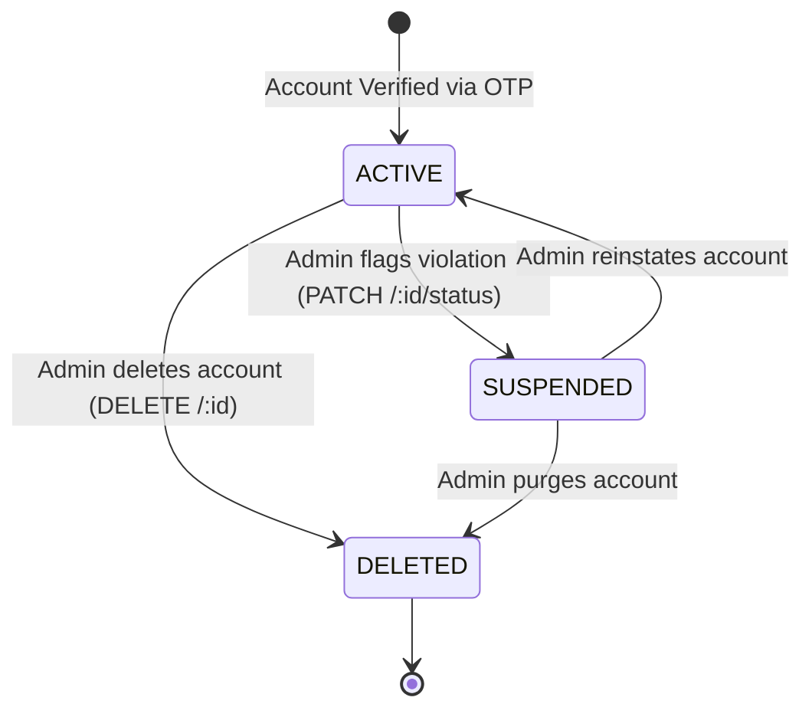

# User Module (`src/modules/user`)

The **User Module** is the administrative user management and platform analytics hub for TeamStreak Promo. It provides super-administrators (`ADMIN`) with the controls to monitor platform users, review account growth, inspect profiles, modify roles, and enforce moderation policies (suspension or account termination).

---

## 1. Overview & Capabilities

- **Admin-Only Operations**: All endpoints in this module are strictly guarded by `protect` and `authorizeRoles('ADMIN')`.
- **System-Wide Analytics**: Generates aggregate metrics on total users, role distribution (`USER`, `HOST`, `BUSINESS`, `ADMIN`), account status breakdowns (`ACTIVE`, `SUSPENDED`, `DELETED`), and platform verification rates.
- **Account Moderation**: Enables administrators to change account status (e.g. suspend bad actors) or elevate/demote user roles.
- **Re-exported Domain Model**: Leverages and extends the central `User` model from `src/modules/auth/auth.model.ts`, ensuring unified document integrity.

---

## 2. Directory Structure

```text
src/modules/user/
├── user.controller.ts    # Handlers for admin user queries, status moderation, and role modifications
├── user.interface.ts     # TypeScript interfaces for query filters, user stats, and admin inputs
├── user.model.ts         # Re-exports User model with pre-registered BusinessProfile schemas
├── user.route.ts         # Express routes guarded entirely by ADMIN role authorization
├── user.service.ts       # Database queries for analytics, pagination, status changes, and deletion
├── user.validation.ts   # Zod validation schemas for query parameters, roles, and status enums
└── README.md             # This documentation file
```

---

## 3. Endpoints & API Reference

Base Prefix: `/api/users`

All routes require authentication (`protect`) and the `ADMIN` role.

| Method | Endpoint | Description |
| :--- | :--- | :--- |
| `GET` | `/stats` | Platform-wide user analytics (counts by role, active vs suspended, verified counts). |
| `GET` | `/` | Paginated listing of all platform accounts with search (name, email), role, and status filtering. |
| `GET` | `/:id` | Detailed profile inspection of a user, including populated `businessProfile`. |
| `PATCH` | `/:id/status` | Change user account status (`ACTIVE`, `SUSPENDED`, `DELETED`). |
| `PATCH` | `/:id/role` | Modify user authorization role (`USER`, `HOST`, `BUSINESS`, `ADMIN`). |
| `DELETE` | `/:id` | Permanently remove or soft-delete user account. |

---

## 4. Administrative Moderation Lifecycle



---

## 5. Security & Isolation Guidelines

- **Self-Demotion Safeguard**: An administrator cannot demote or delete their own active account through this endpoint.
- **Cascade Deletion Awareness**: Deleting a host or merchant account must account for linked events, marketplace items, and Stripe accounts.
